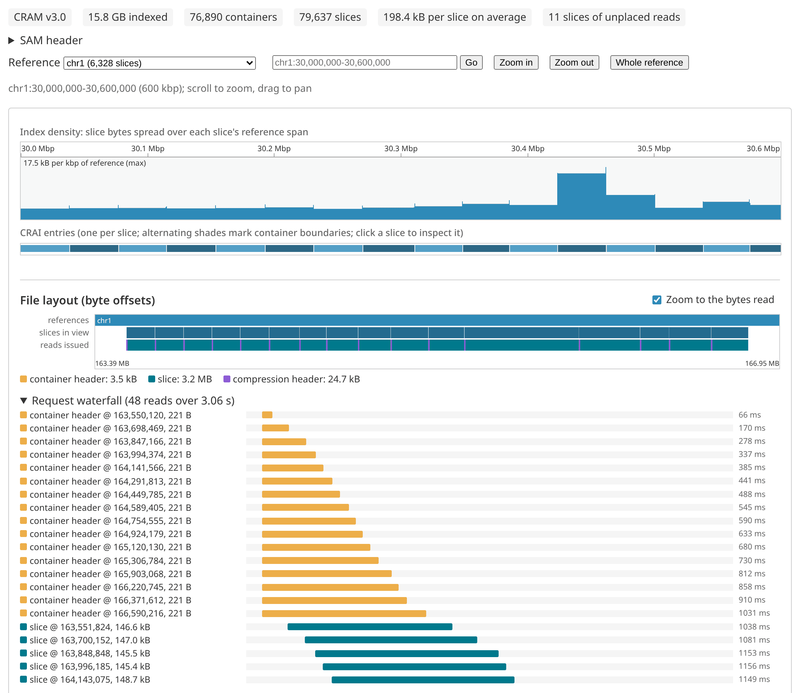
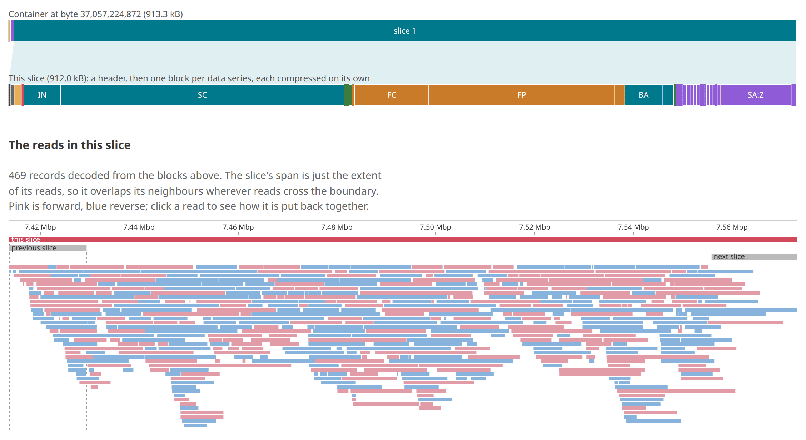
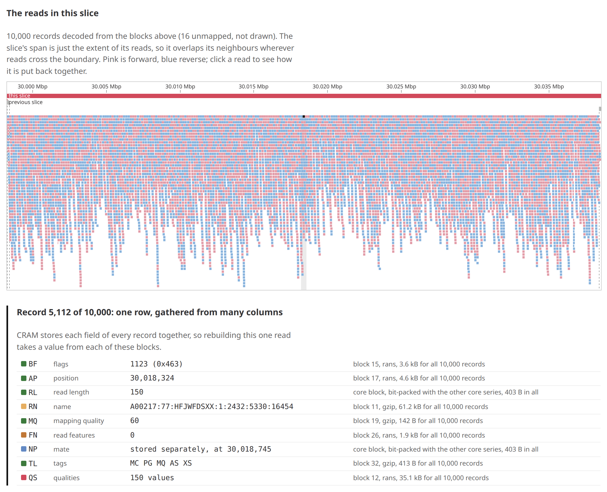

# cram_visualizer

A companion to
[bam_index_visualizer](https://github.com/cmdcolin/bam_index_visualizer), for
CRAM. It shows how a `.crai` maps reference coordinates to byte ranges, what a
query actually reads, and where the bytes inside a slice go.

- **Index density**: each slice's size spread over the reference span it covers,
  an indexcov-style coverage estimate from the `.crai` alone
- **CRAI entries**: one bar per slice, shaded by container; click one to inspect
  it
- **File layout**: references, the slices in view, and the reads `@gmod/cram`
  issued for the last action, on a byte axis, plus a request waterfall
- **Slice inspector**: container and slice headers, a byte map of the container
  zoomed into the slice's blocks, the slice's reads drawn as a pileup against
  its neighbours, one record traced back to the blocks it is decoded from, and
  every block with its data series, codec, and stored vs decompressed size
- **Byte breakdown**: the same per-series totals summed over up to 24 slices in
  view

## Demo

https://cmdcolin.github.io/cram_visualizer

## Screenshots

A 600 kbp query on a 30x Illumina genome: the `.crai` density and slices, where
the reads land in the file, and the request waterfall.

A PacBio slice: the container zoomed into its blocks, and its reads overlapping
the neighbouring slices.

One Illumina read, traced back to the blocks its fields are decoded from.

## Develop

    pnpm install
    pnpm dev
